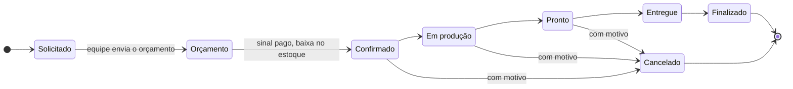
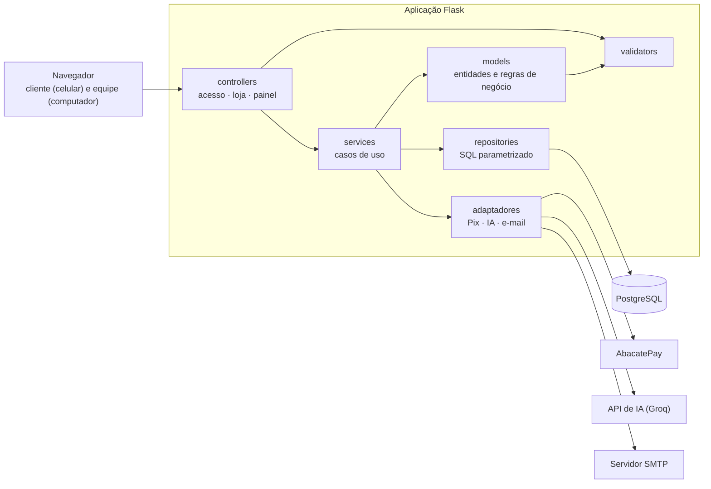

# Sistema de Gestão de Confeitaria

Sistema web integrado de gestão e atendimento para uma confeitaria artesanal. Ele reúne uma **área do cliente**
(mobile-first), para fazer e acompanhar pedidos, e uma **área interna** (desktop-first), para administrar pedidos,
produção, receitas, estoque, compras e clientes. As duas áreas compartilham as mesmas regras de negócio e o mesmo banco
de dados.
 
Projeto da disciplina **Paradigma Orientado a Objetos para Desenvolvimento de Software (INF01210)** da
**Universidade Estadual do Norte Fluminense Darcy Ribeiro (UENF)**, 2026.


## Sumário
 
1. [Visão geral](#visão-geral)
2. [Funcionalidades](#funcionalidades)
3. [Arquitetura](#arquitetura)
4. [Tecnologias](#tecnologias)
5. [Instalação e execução](#instalação-e-execução)
6. [Uso](#uso)
7. [Testes](#testes)
8. [Estrutura de diretórios](#estrutura-de-diretórios)
9. [Documentação complementar](#documentação-complementar)
10. [Autoria](#autoria)

## Visão geral
 
**Contexto.** A confeitaria que motivou o projeto ainda não está formalmente em operação. Hoje a proprietária
produz sob encomenda para pessoas próximas, e os pedidos, o estoque e a precificação são controlados manualmente.
A abertura do negócio está planejada para os próximos anos.
 
**Problema.** No controle manual, os pedidos ficam dispersos entre canais, o estoque de ingredientes e embalagens
não acompanha o consumo real e o preço de cada produto é calculado caso a caso, sem considerar com precisão o custo
dos insumos e das personalizações.
 
**Proposta.** O sistema foi projetado para a operação futura da confeitaria e se concentra em três necessidades
levantadas com a proprietária:
 
1. organizar o estoque de ingredientes e embalagens, com alerta de estoque mínimo;
2. calcular o preço dos produtos a partir das receitas, dos custos e das personalizações;
3. centralizar os pedidos, desde a solicitação do cliente até a entrega ou retirada.
O fluxo principal conecta essas três frentes:
 
```
Cliente → Pedido → Produto → Receita → Insumos → Estoque → Produção → Entrega/Retirada
```

## Funcionalidades
 
### Área do cliente (mobile-first)
 
| Funcionalidade | Descrição |
|---|---|
| Conta | Cadastro, login, verificação de e-mail por link assinado e edição dos dados pessoais |
| Endereços | Cadastro de endereços de entrega reaproveitados entre pedidos |
| Cardápio | Catálogo com busca, filtros (pronta entrega e encomenda) e página de cada produto |
| Carrinho | Itens com personalização (opções com custo adicional) e escolha entre entrega e retirada |
| Fazer pedido | Validação de prazo: encomendas respeitam a antecedência mínima do produto, e a pronta entrega fecha 1 hora antes do encerramento |
| Pagamento | Sinal e restante por Pix (QR Code), via AbacatePay |
| Acompanhamento | Linha do tempo do status do pedido e histórico de pedidos |

### Área interna (desktop-first)
 
| Módulo | Funcionário | Administração |
|---|---|---|
| Início | Indicadores do dia, próximas entregas e retiradas, aniversários da semana | Idem |
| Pedidos | Fila com filtros, detalhes, envio do orçamento e avanço de status | Também registra pagamentos recebidos fora do Pix e cancela pedidos (com motivo) |
| Estoque | Saldo por insumo, alerta de mínimo e lista de compras sugerida | Também cadastra insumos, registra ajustes e perdas (com histórico) e desfaz ajustes |
| Receitas | Consulta, com escala proporcional do rendimento | Cadastro, edição e desativação |
| Produtos | Consulta | Cadastro com custo calculado pela receita, margem, opções de personalização e disponibilidade |
| Compras | | Compras de insumos por fornecedor; o recebimento dá entrada no estoque |
| Fornecedores | | Cadastro de fornecedores |
| Clientes | | Cadastro, histórico de pedidos e marcação de clientes VIP |
| Funcionários | | Cadastro e desativação das contas da equipe |
| Relatórios | | Vendas, produtos e insumos, com gráficos\* |
| Assistente IA | | Recomendações de reposição explicadas e perguntas em linguagem natural\* (ver [Uso](#assistente-ia)) |

\* Exige o atributo `acesso_financeiro` do administrador, porque expõe custos e faturamento.

### Ciclo de vida do pedido
 
As transições permitidas ficam numa única tabela (`StatusPedido`, em `app/models/enums.py`), e qualquer outra
mudança é recusada. A confirmação exige o sinal pago e dá baixa nos insumos no estoque (tudo ou nada); o cancelamento
exige motivo.
 


## Arquitetura
 
Aplicação web monolítica em camadas: um backend Flask que renderiza as páginas no servidor, um banco
PostgreSQL e três serviços externos, todos opcionais e isolados atrás de adaptadores.
 


### Princípios e padrões de projeto
 
| Padrão ou princípio | Onde | Para quê |
|---|---|---|
| Repository | `app/repositories/` | Isolar o SQL; os models não sabem que existe banco |
| Adapter | `gateway_abacatepay.py`, `gateway_ia.py`, `envio_email.py` | Cada API externa fica num único arquivo; trocar de provedor não afeta o resto |
| Protocol (contratos) | `app/models/contratos.py` | Interfaces como `GatewayPagamento`, `ModeloLinguagem` e `Recomendador`; permitem dublês nos testes |
| Injeção de dependência | `app.extensions` | O app usa os serviços reais; os testes trocam por dublês (`tests/falsos.py`) |
| State | `services/controle_login.py` | Estados *livre* e *bloqueado* do controle de tentativas de login |
| Autômato por tabela | `models/enums.py` | Transições de status do pedido declaradas numa tabela, sem condicionais espalhadas |
| Polimorfismo no lugar de condicionais | todo o código | O código não usa `if/elif/else`; usa polimorfismo, tabelas (`dict`/`Enum`) e `garantir(condição, erro)` |

## Tecnologias
 
| Categoria | Tecnologia | Uso |
|---|---|---|
| Linguagem | Python 3.13 | Backend e testes |
| Framework web | Flask 3.1 (Werkzeug, Jinja2, ItsDangerous) | Rotas, páginas, hash de senha e tokens assinados |
| Banco de dados | PostgreSQL 18 | Persistência (em contêiner Docker) |
| Acesso ao banco | psycopg 3 | Driver PostgreSQL com consultas parametrizadas, sem ORM |
| Frontend | HTML5, CSS3, Jinja2 | Páginas renderizadas no servidor; sem framework de JavaScript |
| Testes | pytest 9 | Testes de unidade, integração com o banco e rotas |
| Integração contínua | GitHub Actions | Executa a suíte a cada push e pull request |
| Modelagem | Visual Paradigm | DER, diagrama de classes e casos de uso (`docs/`) |
| Pagamentos | AbacatePay (API REST) | Cobranças Pix (opcional) |
| Inteligência artificial | Groq, modelo `openai/gpt-oss-120b` | Assistente de reposição (opcional) |
| Infraestrutura local | Docker Compose | Banco de dados de desenvolvimento |
 
As integrações externas usam apenas a biblioteca padrão (`urllib`), sem SDKs de terceiros.


## Instalação e execução
 
Os comandos abaixo são executados na raiz do projeto. No Windows, use `copy` no lugar de `cp` e
`venv\Scripts\activate` no lugar de `source venv/bin/activate`.
 
**1. Obter o código**
 
```bash
git clone https://github.com/folkcean/Sistema_Confeitaria.git
cd Sistema_Confeitaria
```
 
**2. Configurar as variáveis de ambiente**
 
```bash
cp .env.example .env
```
 
Edite o `.env` e defina, no mínimo, `POSTGRES_PASSWORD` e `SECRET_KEY`. O arquivo `.env` não é versionado.
 
| Variável | Descrição |
|---|---|
| `POSTGRES_USER`, `POSTGRES_PASSWORD`, `POSTGRES_DB` | Credenciais do banco (as mesmas usadas pelo Docker Compose) |
| `POSTGRES_HOST`, `POSTGRES_PORT` | Endereço do banco (padrão `localhost:5432`) |
| `SECRET_KEY` | Chave que assina sessões e links de verificação; use um valor longo e aleatório |
| `ABACATEPAY_API_KEY` | Chave da AbacatePay; uma chave `abc_dev_...` ativa o Modo Teste |
| `EMAIL_SMTP_HOST`, `EMAIL_SMTP_PORTA`, `EMAIL_SMTP_USUARIO`, `EMAIL_SMTP_SENHA`, `EMAIL_SMTP_TLS`, `EMAIL_REMETENTE` | Envio do e-mail de verificação; sem `EMAIL_SMTP_HOST`, o link é exibido no terminal |
| `IA_URL_BASE`, `IA_CHAVE`, `IA_MODELO` | API de IA no formato *chat completions* (padrão: Groq) |
 
Uma `SECRET_KEY` adequada pode ser gerada com:
 
```bash
python -c "import secrets; print(secrets.token_hex(32))"
```
 
**3. Subir o banco de dados**
 
```bash
docker compose up -d
docker compose ps          # aguarde o status "healthy"
```
 
Na primeira execução, o contêiner cria as tabelas a partir de `db/init/`. Em seguida, aplique as migrações de
`db/update/`, em ordem numérica, uma única vez por banco:
 
```bash
docker compose exec -T db psql -U app -d appdb -v ON_ERROR_STOP=1 --single-transaction < db/update/001_adiciona_email_verificado.sql
```
 
**4. Instalar as dependências**
 
```bash
python -m venv venv
source venv/bin/activate
pip install -r requirements.txt
```
 
**5. Carregar os dados de demonstração (opcional)**
 
```bash
docker compose exec -T db psql -U app -d appdb -v ON_ERROR_STOP=1 < tests/db/DB_fill.sql
```
 
> Este script **apaga os dados existentes** antes de inserir os de demonstração
 
**6. Executar a aplicação**
 
```bash
flask run
```


## Uso
 
### Fluxo principal
 
1. **Cliente** (celular): acessa o cardápio, adiciona um produto ao carrinho, escolhe entrega ou retirada e envia o
   pedido, que fica como *Solicitado*.
2. **Equipe** (computador): abre o pedido e envia o orçamento, e o pedido passa a *Orçamento*.
3. **Cliente**: paga o sinal por Pix na página do pedido.
4. **Equipe**: confirma o pedido. Nesse momento, os insumos das receitas são descontados do estoque; se
   faltar algum, a confirmação é recusada e nada é alterado.
5. **Equipe**: avança o pedido para *Em produção*, *Pronto* e *Entregue*. O cliente acompanha cada etapa na linha do
   tempo do pedido.

### Assistente IA
 
Na área interna, a aba **Assistente IA** (administração com acesso financeiro) analisa o estado atual do estoque e
recomenda o que repor, quanto comprar e até quando, com a justificativa de cada recomendação. Também responde perguntas
sobre estoque, compras, pedidos e vendas, digitadas ou escolhidas entre perguntas prontas.
 
A cada solicitação, o sistema executa três consultas em transação **somente leitura** (insumos, pedidos em aberto e
vendas por semana), combina o resultado com as regras de reposição de
[`app/conhecimento/reposicao.md`](app/conhecimento/reposicao.md) e envia o conjunto à API de IA. O modelo não tem
acesso ao banco, e nenhum dado pessoal de cliente é enviado. As regras podem ser alteradas nesse arquivo sem
reiniciar a aplicação.
 
Exemplo de recomendação retornada (formato garantido por esquema JSON) para os dados de demonstração:
 
```json
{
  "insumo": "Acucar refinado",
  "prioridade": "alta",
  "comprar": 1.8,
  "unidade": "kg",
  "pedir_ate": "2026-11-17",
  "fornecedor": "",
  "motivo": "Já está abaixo do mínimo e não há compra a caminho.",
  "fatores": [
    "saldo 8,73 kg − reservado 0,28 kg = 8,45 kg, abaixo do mínimo de 10 kg",
    "consumo de 0,009 kg por dia nos últimos 30 dias",
    "ponto de pedido 10 + 0,009 × 3 = 10,03 kg"
  ]
}
```
 
O assistente apenas recomenda: a decisão e o registro da compra continuam com a proprietária.

## Testes
 
O projeto tem **1.268 testes**. Os testes de banco e de rotas usam o PostgreSQL local; cada teste roda numa transação desfeita ao final, de
modo que o banco não é alterado.
 
```bash
source venv/bin/activate
pytest -q                                          # completo (requer o banco ligado)
pytest tests/models tests/services tests/validators -q   # apenas os testes sem banco
```
 
Saída esperada da bateria de testes completa:
```
1260 passed, 1 skipped, 7 xfailed
```
 
| Pasta | Testes | O que cobre |
|---|---:|---|
| `tests/models` | 294 | Regras de negócio das entidades (prazos, transições de status, estoque, receitas, privacidade) |
| `tests/services` | 177 | Casos de uso (baixa de estoque, precificação, pagamento, login, e-mail, assistente IA) |
| `tests/validators` | 119 | Validação de campos, senhas e prazos |
| `tests/db` | 42 | Repositórios contra o PostgreSQL, com os dados de demonstração |
| `tests/rotas` | 636 | Rotas Flask, incluindo a matriz de acesso, que verifica cada rota para cada perfil |
 
Nenhum teste acessa a internet: os serviços externos (Pix, e-mail e IA) são substituídos por dublês definidos em
`tests/falsos.py`.

## Estrutura de diretórios
 
```
Sistema_Confeitaria/
├── app/
│   ├── controllers/      # rotas: acesso (login e cadastro), loja (cliente), painel (área interna), sessao
│   ├── models/           # entidades do DER e regras de negócio; contratos (Protocols) e enumerações
│   ├── services/         # casos de uso e adaptadores das APIs externas (Pix, IA, e-mail)
│   ├── repositories/     # acesso ao PostgreSQL, uma classe por agregado
│   ├── validators/       # validação de campos, senhas e prazos
│   ├── conhecimento/     # regras de reposição usadas pelo Assistente IA (Markdown)
│   ├── templates/        # páginas Jinja2: acesso/, loja/, painel/ e componentes compartilhados
│   ├── static/           # CSS, imagens e fotos dos produtos
│   ├── config.py         # configuração lida do .env (aplicação e testes)
│   ├── exceptions.py     # hierarquia de exceções do domínio
│   └── __init__.py       # fábrica da aplicação (create_app)
├── db/
│   ├── init/             # script de criação do banco, gerado a partir do DER
│   └── update/           # migrações numeradas, aplicadas em ordem
├── docs/                 # modelos UML e DER (Visual Paradigm), guia de desenvolvimento e imagens
├── tests/
│   ├── models/  services/  validators/   # testes sem banco
│   ├── db/               # testes de repositório e dados de demonstração (DB_fill.sql)
│   ├── rotas/            # testes das rotas e matriz de acesso
│   └── falsos.py         # dublês dos serviços externos
├── .github/workflows/    # integração contínua (GitHub Actions)
├── docker-compose.yml    # PostgreSQL para desenvolvimento
├── requirements.txt      # dependências Python com versões fixadas
├── pytest.ini
└── run.py                # ponto de entrada da aplicação
```

## Documentação complementar
 
| Documento | Conteúdo |
|---|---|
| `docs/Sistema Confeitaria.vpp` | Modelagem no Visual Paradigm (DER, diagrama de classes e casos de uso). O DER é a referência para qualquer alteração no banco |
| [`docs/desenvolvimento.md`](docs/desenvolvimento.md) | Convenções de código, processo de alteração do banco e fluxo de versionamento da equipe |
| [`app/conhecimento/reposicao.md`](app/conhecimento/reposicao.md) | Regras de reposição aplicadas pelo Assistente IA |

## Autoria
 
Desenvolvido por:
 
- **Anna Cecília Garcia** · [@folkcean](https://github.com/folkcean)
- **Iarlo Henrique Drumond Pires Pascoal** · [@iarloo](https://github.com/iarloo)